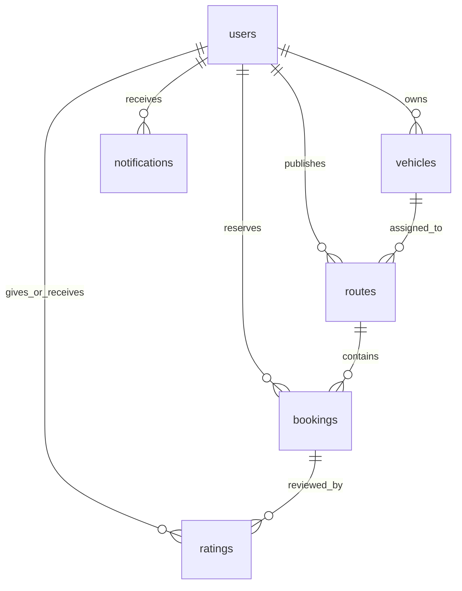

# Carpool — Technical Architecture & viva/Interview Guide

This document is written for viva examiners, interviewers, and engineers reviewing the system. It explains the entire architecture, design decisions, data models, key algorithms, and edge cases.

---

## 1. What the Project Does

Carpool is a localized, web-based ride-sharing application designed exclusively for daily commuters and short intercity travellers in Tamil Nadu, India. Instead of operating as an on-demand commercial taxi dispatch system, Carpool enables drivers (operating bikes, autos, or cabs) to publish routes they are already scheduled to travel. Riders commuting along the same corridor can book available seats along that journey. The system dynamically matches riders whose pickup and drop locations fall within 1.5 km of the driver's path, enforces strict atomic transactions to eliminate overbooking, shields personal contact details until a seat is confirmed, and splits the travel fare per segment based on real-time vehicle occupancy.

---

## 2. Technology Choices & Justifications

| Technology | Role in Carpool | Why Chosen Over Main Alternative |
| :--- | :--- | :--- |
| **React + TypeScript (Strict)** | Single-page frontend UI | React provides declarative component rendering and clean local state handling without the heavy abstraction layers or bundle footprint of larger frameworks. |
| **Vite** | Frontend build tool and dev server | Sub-second cold starts and rapid Hot Module Replacement (HMR) using native ES modules, drastically simpler to configure than webpack. |
| **React Router v6** | Client-side routing and protected paths | Standard declarative routing with clean URL parameter support and layout outlet hierarchies, avoiding extra state machine libraries. |
| **Plain CSS with Custom Tokens** | Design system styling | Zero runtime overhead and completely explainable styles with no external UI kit dependencies (like Tailwind or MUI) that obfuscate underlying CSS rules. |
| **Leaflet + OpenStreetMap** | Interactive mapping and route rendering | Free, open-source mapping engine without paid API keys, vendor lock-in, or credit card requirements compared to Google Maps SDK. |
| **Nominatim API (OSM)** | Geocoding and place autocompletion | Bounded to Tamil Nadu (`countrycodes=in&bounded=1`) with native Tamil script support, completely free of charge. |
| **OSRM Public API** | Driving route geometries and distance | Provides fast turn-by-turn routing polylines without costly Google Directions API subscriptions. |
| **Node.js + Express** | Backend REST API server | Minimalist, predictable HTTP request/response pipeline in TypeScript with explicit routing middleware. |
| **better-sqlite3** | Embedded relational database | Synchronous, zero-configuration local database storing everything in a single portable file with native atomic transactions; avoids heavy Dockerized Postgres setup. |
| **Plain SQL (schema.sql)** | Database structure and queries | Pure, readable SQL with zero ORM abstraction layers (like Prisma or TypeORM), making query execution plans and schema relationships immediately obvious. |
| **bcrypt** | Password hashing | Industry-standard salted adaptive key derivation function with 10 rounds, mitigating rainbow table attacks. |
| **jsonwebtoken (JWT) + httpOnly Cookie** | User authentication session | Storing cryptographically signed JWTs in httpOnly, SameSite cookies prevents client-side XSS attacks from reading or exfiltrating tokens. |
| **Zod** | Request validation schema | Provides compile-time TypeScript type inference and runtime boundary validation with descriptive error feedback. |
| **Vitest** | Automated unit testing framework | Fast, native ESM test runner that shares Vite's configuration and module resolution rules, avoiding Jest's complex Babel transforms. |

---

## 3. End-to-End Request Walkthrough: "Request Seat"

Here is the exact step-by-step lifecycle of what happens when a rider clicks **"Request 1 seat"**:

```
[Rider Browser] -> POST /api/bookings -> [Express Router] -> [Auth Middleware]
                 -> [Zod Validation] -> [Booking Service Transaction]
                 -> [better-sqlite3] -> [Notification Service] -> [Driver View]
```

1. **User Action (Client)**:
   - File: `client/src/pages/RideDetail.tsx`
   - The rider selects pickup, drop, and seat count, and submits the form.
   - The client calls `api.post('/bookings', { route_id, pickup_name, pickup_lat, pickup_lng, drop_name, drop_lat, drop_lng, seats_booked })`.
2. **Network Transport**:
   - The browser dispatches an HTTP `POST` request to `http://localhost:3001/api/bookings`. The browser automatically attaches the `token` cookie (`credentials: 'include'`).
3. **Authentication Verification**:
   - File: `server/src/middleware/auth.ts`
   - Express runs `authenticate()`. It reads `req.cookies.token`, verifies it using `jwt.verify(token, JWT_SECRET)`, and decodes the rider's ID, attaching it to `req.user`.
4. **Payload Validation**:
   - File: `server/src/middleware/validate.ts` & `server/src/routes/booking.routes.ts`
   - `validate(requestBookingSchema)` parses `req.body`. If coordinates or seat counts are invalid, it halts and returns HTTP 400.
5. **Business Logic & Transactional Safety**:
   - File: `server/src/services/booking.service.ts` (`requestBooking`)
   - `db.transaction()` starts an immediate SQLite transaction.
   - Queries `routes` by `route_id`. Checks:
     - Is the route status `'active'`?
     - Is the driver someone other than the rider?
     - Is `seats_available >= seats_booked`?
     - Does the rider already have an active request?
   - Server recomputes the fair travel distance via `haversineDistance()` and calls `estimateFare()` to ensure the rider cannot forge the price from DevTools.
   - Executes an `INSERT INTO bookings` with status `'requested'`. Note: Seats are not yet decremented until driver confirmation.
6. **In-App Notification Generation**:
   - File: `server/src/services/notification.service.ts`
   - An `INSERT INTO notifications` record is created for the driver: *"New seat request for route #... from Tambaram to Guindy"*.
7. **Commit & Response**:
   - SQLite commits the transaction to `carpool.db`.
   - The route handler responds with `HTTP 201 Created` and the new booking object.
8. **Driver Interface Update**:
   - Files: `client/src/components/Notifications.tsx` & `client/src/pages/RideDetail.tsx`
   - The driver's background notification poller detects the unread count increase and rings the bell icon.
   - If the driver visits `RideDetail.tsx`, the route's incoming requests list displays the new passenger with **Accept** and **Decline** actions.

---

## 4. Database Schema and Relationships

All tables are created in `server/src/db/schema.sql` with foreign key enforcement (`PRAGMA foreign_keys = ON;`).



### Table Explanations:
1. **`users`**: Stores user identity, bcrypt-hashed credentials, contact phone numbers (+91), and account creation timestamps.
2. **`vehicles`**: Stores vehicles owned by drivers. Tracks type (`bike`, `auto`, `cab`), registration plate (validated against Tamil Nadu `TN` format), model, colour, and passenger capacity.
3. **`routes`**: Stores journeys published by drivers. Contains origin and destination coordinates, intermediate waypoints (stored as JSON arrays), encoded OSRM polyline strings, departure time, recurring days, seat counts, and per-km pricing.
4. **`bookings`**: Stores individual seat reservations along a route. Holds passenger pickup/drop coordinates, requested seats, server-calculated fare, and lifecycle status (`requested`, `confirmed`, `declined`, `cancelled`, `in_progress`, `completed`).
5. **`ratings`**: Stores 1 to 5 star scores and comments linked to completed bookings between riders and drivers. Enforces uniqueness so one booking cannot be reviewed twice by the same user.
6. **`notifications`**: Stores in-app alerts (booking alerts, confirmations, trip state transitions) for users.
7. **`reports`**: Safety reporting table recording complaints filed against users.
8. **`blocks`**: Stores user-to-user blocking relationships for privacy and security.

---

## 5. Key Algorithms with Tamil Nadu Worked Examples

### Algorithm 1: Route Matching & Spatial Detour Filtering

#### Purpose:
Determine whether a rider's requested trip (Pickup $P$ and Drop $D$) can be serviced by a driver's existing path without detouring more than 1.5 km.

#### Steps:
1. Decode the driver's route polyline into an ordered sequence of coordinates $[C_0, C_1, C_2, \dots, C_n]$.
2. For the rider's pickup location $P$, find the nearest coordinate $C_i$ on the polyline using the Haversine distance formula:
   $$d = 2R \arcsin\left(\sqrt{\sin^2\left(\frac{\Delta\text{lat}}{2}\right) + \cos(\text{lat}_1)\cos(\text{lat}_2)\sin^2\left(\frac{\Delta\text{lng}}{2}\right)}\right)$$
3. If the minimum distance $\text{dist}(P, C_i) > 1.5\text{ km}$, reject the match.
4. For the rider's drop location $D$, find the nearest coordinate $C_j$ on the polyline. If $\text{dist}(D, C_j) > 1.5\text{ km}$, reject.
5. **Directional Invariant Check**: The pickup index $i$ must be strictly less than the drop index $j$ ($i < j$). If $i \ge j$, the rider is travelling in the reverse direction.
6. Calculate total detour $\text{detour} = \text{dist}(P, C_i) + \text{dist}(D, C_j)$.
7. Rank all valid matching routes by:
   - Detour distance ascending (minimal diversion)
   - Departure time closeness
   - Price per km ascending

#### Numeric Example:
- **Driver Route**: Chennai Central ($13.0827, 80.2707$) to Tambaram ($12.9249, 80.1000$) via Guindy Kathipara ($13.0067, 80.2206$).
- **Rider A Request**: Chromepet GST Road ($12.9516, 80.1462$) to Tambaram Station.
  - Pickup distance to nearest highway point: $0.15\text{ km} \le 1.5\text{ km}$ (Valid).
  - Drop distance to terminus: $0.10\text{ km} \le 1.5\text{ km}$ (Valid).
  - Pickup index: $12$, Drop index: $18$ ($12 < 18$, forward direction).
  - **Result**: Match confirmed. Total detour: $0.25\text{ km}$.
- **Rider B Request**: Tambaram to Guindy (Reverse direction on this southbound commute).
  - Pickup index: $18$, Drop index: $8$ ($18 > 8$).
  - **Result**: Rejected (reverse commute).

---

### Algorithm 2: Segment-Based Fare Splitting

#### Purpose:
Ensure riders only pay for the exact distance they travel, and split the vehicle cost equally among everyone occupying the vehicle on each individual segment, including the driver.

#### Steps:
1. Collect all pickup and drop events along the route distance, sorted by distance from origin: $\{e_1, e_2, \dots, e_m\}$.
2. The driver is continuously present in the vehicle for the entire journey.
3. For each contiguous segment $[e_k, e_{k+1}]$:
   - Segment distance $\Delta s = \text{km}(e_{k+1}) - \text{km}(e_k)$.
   - Active occupant count $N = 1 \text{ (driver)} + \sum \text{seats of active passengers}$.
   - Total segment cost $C_{\text{seg}} = \Delta s \times \text{price\_per\_km}$.
   - Per-person cost share $S = \frac{C_{\text{seg}}}{N}$.
   - Allocate $S \times \text{seats}$ to each passenger present during segment $k$.
4. Each passenger's total fare is the sum of their shares across all segments they were present.

#### Numeric Example (Chennai Corridor):
- **Route**: Tambaram to T. Nagar (18 km total at ₹14/km cab rate).
- **Rider 1**: Tambaram (km 0) to Guindy Kathipara (km 12) — 1 seat.
- **Rider 2**: Chromepet (km 5) to T. Nagar (km 18) — 1 seat.

| Segment | Distance | People in Vehicle | Segment Cost | Cost per Person |
| :--- | :--- | :--- | :--- | :--- |
| **0 km – 5 km** (Tambaram to Chromepet) | 5 km | Driver + Rider 1 (2 people) | $5 \times 14 = ₹70$ | $70 / 2 = ₹35.00$ |
| **5 km – 12 km** (Chromepet to Guindy) | 7 km | Driver + Rider 1 + Rider 2 (3 people) | $7 \times 14 = ₹98$ | $98 / 3 = ₹32.67$ |
| **12 km – 18 km** (Guindy to T. Nagar) | 6 km | Driver + Rider 2 (2 people) | $6 \times 14 = ₹84$ | $84 / 2 = ₹42.00$ |

**Final Outcome**:
- **Rider 1 pays**: $₹35.00 + ₹32.67 = \mathbf{₹67.67}$ (Down from solo cost of $12 \times 14 = ₹168$).
- **Rider 2 pays**: $₹32.67 + ₹42.00 = \mathbf{₹74.67}$ (Down from solo cost of $13 \times 14 = ₹182$).
- **Driver's personal share**: $₹35.00 + ₹32.67 + ₹42.00 = \mathbf{₹109.67}$ (Saved ₹142.33 on their daily drive).

---

## 6. 25 Likely Viva / Interview Questions and Answers

### 1. Why did you use SQLite instead of PostgreSQL or MongoDB?
SQLite requires zero daemon setup, runs embedded in the Node process via `better-sqlite3`, stores all state in a single portable file, and natively supports ACID transactions and WAL mode. For a local project and viva evaluation, it is completely self-contained.

### 2. How is simultaneous overbooking prevented if two riders request at the exact same millisecond?
When a driver accepts a booking, `acceptBooking()` executes inside a SQLite transaction:
```sql
UPDATE routes SET seats_available = seats_available - ? WHERE id = ? AND seats_available >= ?;
```
SQLite's table-level lock in WAL mode ensures serialized execution, and the check `seats_available >= ?` plus the table constraint `CHECK(seats_available >= 0)` guarantees seat counts never drop below zero.

### 3. Why are passwords hashed with bcrypt instead of SHA-256 or MD5?
SHA-256 and MD5 are general-purpose cryptographic hashes optimized for speed, making them vulnerable to GPU-based brute-force and rainbow table attacks. bcrypt is an adaptive hash function with a configurable work factor (salt rounds = 10) and internal salting specifically designed for password storage.

### 4. Why is the JWT stored in an httpOnly cookie rather than localStorage?
Tokens stored in `localStorage` are accessible by any JavaScript running in the browser, making them vulnerable to Cross-Site Scripting (XSS) exfiltration. An `httpOnly` cookie cannot be read by JavaScript and is automatically transmitted with same-origin HTTP requests.

### 5. Why do we not trust fare values sent from the frontend?
A client could easily open browser DevTools and modify the HTTP request payload to send `fare: 1`. The server recomputes the distance using Haversine formulas and recalculates the fare from the route's database price-per-km before inserting the record.

### 6. How does the route matching algorithm work without expensive GIS databases like PostGIS?
The route geometry is stored as an encoded polyline. The server decodes it into a sequence of latitude/longitude points and applies Haversine distance calculations to find the closest point for pickup and drop. If both points are within 1.5 km and the pickup index is less than the drop index, it's a match.

### 7. What prevents a passenger from travelling in the opposite direction along a route?
We track the array index of the closest polyline point. If `pickup_index >= drop_index`, the pickup occurs after or at the drop point along the driver's forward progression, and the match is discarded.

### 8. What is WAL mode in SQLite and why did you enable it?
Write-Ahead Logging (WAL) allows concurrent readers and a writer simultaneously. Readers do not block writers, and writers do not block readers, providing significantly better performance for web apps.

### 9. Why use Nominatim with bounding rather than global geocoding?
We restrict geocoding queries with `countrycodes=in` and `viewbox=76.2,13.6,80.4,8.0` with `bounded=1`. This confines autocomplete search results to Tamil Nadu, eliminates false positives from other regions, and complies with OpenStreetMap usage policies.

### 10. Why did you debounce the location autocomplete input?
Without debouncing (400 ms), every single keystroke would fire an HTTP request to Nominatim, quickly triggering rate limits (1 req/sec policy) and lagging the user interface.

### 11. How does Tamil script render properly across the application?
The font fallback chain specifies `'DM Sans', 'Noto Sans Tamil', system-ui, sans-serif`. When Nominatim returns Tamil place names (e.g. தாம்பரம்), the browser smoothly falls back to Noto Sans Tamil or system glyphs without broken boxes ("tofu").

### 12. How is driver and rider privacy protected before a booking is confirmed?
The backend hides the driver's phone number and exact address in the API response until a booking status reaches `'confirmed'`, `'in_progress'`, or `'completed'`. Before that, only approximate area names and vehicle classifications are shown.

### 13. What happens when a confirmed booking is cancelled?
The cancellation logic runs inside a transaction: it updates the booking status to `'cancelled'`, increments the route's `seats_available` by the number of booked seats, and creates an in-app notification for the other party.

### 14. What is the difference between this app and a standard taxi aggregator (like Uber or Ola)?
In taxi services, the driver takes on a dedicated trip solely for the rider on demand. In Carpool, the driver is already travelling on their own regular commute (e.g. home to office). Riders simply tag along and share fuel expenses.

### 15. Why use pure CSS tokens instead of Tailwind CSS or Bootstrap?
Custom CSS tokens in `tokens.css` give full control over WCAG AA contrast colors, spacing, and typography without requiring a runtime CSS framework or large utility classes that make code hard to read and explain in an interview.

### 16. Why did you use Lucide icons exclusively?
Lucide icons are tree-shakeable, modern, consistent in stroke-width, and lightweight, avoiding emoji inconsistencies across different operating systems.

### 17. How does the driver edit a route after publishing?
Drivers can update waypoints, departure times, seats offered, pricing, or driver notes. If seats offered changes, the server adjusts `seats_available` accordingly while ensuring it never drops below zero.

### 18. What happens if the driver cancels an entire route?
All associated `'requested'` and `'confirmed'` bookings are automatically updated to `'cancelled'` in a single transaction, and notifications are dispatched to all affected passengers.

### 19. How is the state of a trip progressed?
A state machine handles transitions:
`active` route $\rightarrow$ `startTrip()` marks confirmed bookings as `in_progress` $\rightarrow$ `completeTrip()` marks route and bookings as `completed`, allowing both parties to exchange 1–5 star ratings.

### 20. How does the frontend keep track of unread notifications?
The `Notifications` component polls `GET /api/notifications` every 30 seconds, maintaining a live unread badge count without requiring a complex WebSocket server for local development.

### 21. How are Tamil Nadu vehicle registration plates validated?
A regular expression `^TN\s?\d{2}\s?[A-Z]{1,2}\s?\d{4}$/i` validates that the registration number conforms to the official Tamil Nadu RTO plate numbering format (e.g., `TN 09 AB 1234`).

### 22. What would you change to scale this app to 100,000 daily commuters?
1. Replace SQLite with PostgreSQL + PostGIS for spatial spatial indexing (`ST_DWithin` on geometry lines).
2. Use Redis for session caching and Pub/Sub notifications.
3. Replace 30s notification polling with WebSockets or Server-Sent Events (SSE).
4. Run background workers (BullMQ) for OSRM route calculations and push notifications.

### 23. What architecture pattern did you use for the backend?
Layered architecture: Routes handle HTTP parameter extraction and response statuses; Middleware handles auth and validation; Services encapsulate all business logic and database transactions; Database module encapsulates SQLite connections.

### 24. Why did you not use a frontend state management library like Redux or Zustand?
The application's state requirements are modular: authentication state is scoped to `AuthContext`, form states are local to each screen, and data is fetched via typed API helpers. Introducing Redux would add boilerplate without architectural benefit.

### 25. How do you ensure accessibility (a11y) across the application?
All interactive controls use semantic HTML (`<button>`, `<nav>`, `<main>`), inputs have explicit `<label>` bindings, focus rings are styled via `:focus-visible`, and `prefers-reduced-motion` is respected.

---

## 7. Limitations and Future Work

1. **OSRM Public Server Dependency**:
   - *Current state*: The project queries the public demo server `router.project-osrm.org`.
   - *Limitation*: The public server has rate limits and occasionally throttles requests.
   - *Future Work*: Host a local OSRM Docker container with an extract of Tamil Nadu OpenStreetMap data (`tamil-nadu-latest.osm.pbf`).
2. **GPS Live Tracking**:
   - *Current state*: Trip statuses transition manually (`startTrip` and `completeTrip`).
   - *Future Work*: Integrate browser Geolocation API (`navigator.geolocation.watchPosition`) to transmit real-time vehicle coordinates along the route polyline.
3. **Payment Gateway Integration**:
   - *Current state*: Fares are calculated and tracked for cost splitting; settlements are handled directly between commuters (cash / UPI).
   - *Future Work*: Integrate UPI Deep Linking (intent URLs `upi://pay?pa=...`) or Razorpay escrow for automatic post-trip split settlement.
4. **Offline Resilience**:
   - *Current state*: Requires an active internet connection to load map tiles and Nominatim queries.
   - *Future Work*: Cache static map tiles for key corridors (Chennai GST Road, OMR, Coimbatore Avinashi Road) using Service Workers.

---

## 8. Deployment Architecture (Single Service on Render)

### 1. Why Run as One Single Service
Rather than deploying the frontend as a separate static site (e.g. S3/Vercel) and the backend as a separate API server, Carpool compiles into a unified single Node.js web service. In production (`NODE_ENV=production`), Express statically serves the pre-bundled React SPA from `client/dist` and routes all non-`/api` requests to `index.html` to support React Router deep linking. This design:
- Avoids cross-origin complexity and eliminates CORS preflight roundtrip delays (`OPTIONS` requests).
- Reduces cloud infrastructure costs by utilizing a single free-tier server instance.
- Simplifies operational monitoring with a single health check (`/api/health`) and unified stdout logs.
- Requires no Docker or container virtualization overhead.

### 2. Why a Cookie Works on One Origin
When both the browser SPA and the API reside on the exact same domain and port (e.g., `carpool.onrender.com`), authentication cookies are treated as first-party cookies:
- **Zero Third-Party Blocking**: Strict browser privacy mechanisms (like Safari ITP and Chrome third-party cookie deprecation) block cross-site cookies, but fully allow same-origin first-party cookies.
- **Security**: The cookie is flagged `httpOnly: true` (preventing malicious JavaScript from reading or exfiltrating session tokens via XSS) and `sameSite: 'lax'` (providing built-in CSRF protection against cross-site form submissions).
- **Automatic Transport**: The browser automatically attaches the cookie to all relative API calls (`fetch('/api/...')`) without requiring custom Authorization header parsing or manual client storage.

### 3. SQLite Storage Limitations on Cloud Platforms
On hosting platforms like Render's free tier, compute instances operate with an ephemeral filesystem:
- **The Limitation**: Whenever the web service restarts, redeploys, or wakes up from an idle sleep cycle, changes to the local filesystem are reset to the git commit state.
- **The Self-Healing Solution in Carpool**: The database connection layer inspects the SQLite file on startup: if `carpool.db` is missing or tables are uninitialized, it immediately runs `schema.sql`. If the `users` table is empty, it automatically triggers `runSeed()`. This ensures the application is completely resilient and functional after every restart or redeployment.
- **Production Path**: For long-term data persistence without resetting across redeploys, attach a Render Persistent Disk to `./data` or connect to an external managed PostgreSQL database.

